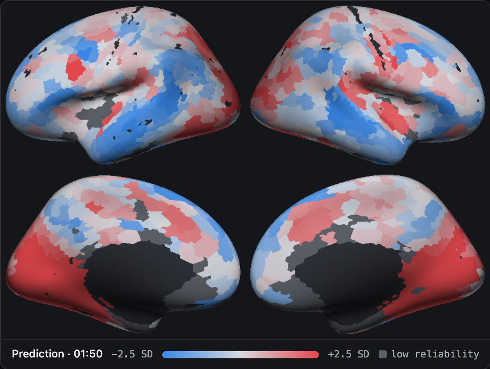
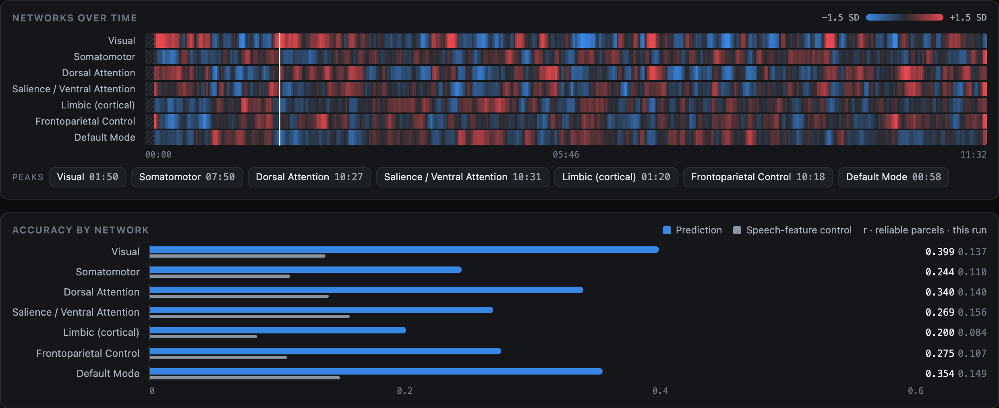

# cortexlive

Predicts how the human cortex responds to a video, live, on a Mac. Drop in any video and
every 1.49 s (one fMRI volume) it shows the predicted fMRI response of 1000 cortical
parcels (patches of cortex) for four people who were scanned while watching TV and films.



*Participant sub-01 at 01:50 of Friends s06e01a (`runs/live_demo/friends_s06e01a`).*

Built with Llama, V-JEPA 2 and w2v-BERT 2.0, and trained on fMRI from the Courtois
NeuroMod (CNeuroMod) project. See [Credits and licenses](#credits-and-licenses).

## Requirements

- A Mac with Apple silicon on macOS 14 or later, with about 10 GB of free disk. The model
  uses up to about 9 GB of memory while it runs.
- [Homebrew](https://brew.sh), then `brew install uv ffmpeg`.
- The trained model, `Llama-cortexlive-v0.1.0.tar.gz` (60 MB), attached to the
  [v0.1.0 release](https://github.com/nihalssingh/cortexlive/releases/tag/v0.1.0).
  `cortexlive setup` downloads it and prints its SHA-256, which should be
  `abd6057678c1baba2d20443f96253b09546177265c68d6f2ebb994d89262211a`.
- Optional: a Hugging Face account with access to
  [Llama 3.2 1B](https://huggingface.co/meta-llama/Llama-3.2-1B), which reads transcripts:
  those of the Friends and Movie10 files ([below](#friends-and-movie10)), or one given with
  `--transcript`. Your own videos don't need it; [reproducing](#reproduce) the model does.
  Meta approves requests by hand.

## Install

```sh
git clone https://github.com/nihalssingh/cortexlive
cd cortexlive
uv sync --extra live
source .venv/bin/activate
cortexlive setup --models https://github.com/nihalssingh/cortexlive/releases/download/v0.1.0/Llama-cortexlive-v0.1.0.tar.gz
```

`setup` installs the model (`--models` also takes a path to a downloaded copy), downloads
the video and audio backbones from Hugging Face (3.6 GB) and checks the machine; it ends
with `ready`, or with `not ready` and a MISSING line for each problem. `cortexlive doctor`
repeats the check. With Llama access, run `hf auth login` first and `setup` downloads
Llama 3.2 1B too (2.5 GB); to add it later, run `hf auth login`, then `cortexlive setup`.
In a new terminal window, run `cd cortexlive` and `source .venv/bin/activate` before using
`cortexlive`.

## Open the viewer

In Finder, open the repository folder (the one with this README) and double-click
**cortexlive.command**. It starts the viewer and opens it in your browser at
http://localhost:8765/: if that port is taken it uses the next free one up to 8775, and if
your viewer is already running it reopens that one. From a terminal, `cortexlive view`
starts it on port 8765 (`--port` picks another).

Drop a video onto the page:

1. The models load, then the video plays from the beginning. fMRI measures blood flow,
   which responds several seconds after what is seen and heard, so each volume is
   predicted from the 7.5 s of video that ended 3 s before it, and, as in training, the
   first 5 volumes are left out. The predicted cortex starts at 0:07 and then updates
   every 1.49 s.
2. When the video ends, the run becomes a recording: scrub through it, switch participant
   and map, and see each brain network over time. **Run live again** recomputes it.
3. Press ctrl-c in the Terminal window, or close it, to stop. Every run that gets past
   0:07 without an error is saved in `captures/`.

The page is `cortexlive/viewer/index.html`. It only works when the viewer serves it,
because the model runs in the viewer process. The viewer listens only on this Mac
(127.0.0.1): a dropped video is copied into its capture and never leaves the machine.
Chrome and Safari both work. Safari cannot play `.mkv` files: the predictions still run,
without the picture. If the browser starts the video muted, click **Turn on sound**.

## Run from the terminal

```sh
cortexlive run ~/Movies/clip.mp4
```

The run goes at real-time speed (`--fast` goes as fast as the machine allows), prints a
summary and saves a capture in `captures/` (`--out DIR` picks the folder). It ends by
printing the command that opens the capture in the viewer. `--transcript words.tsv` gives
any video a transcript in the CNeuroMod format (a `words_per_tr` column with one row per
1.49 s, each a list of the words spoken, such as `['Hi', 'there']`), which needs
Llama 3.2 1B; `--transcript none` leaves out a recognised file's transcript. To turn a
capture into a single HTML file:

```sh
cortexlive export captures/clip-20261010-101500
```

The file opens in any browser without the viewer. It does not contain the video: click
**Attach the video** in the page to add your copy.

Only one cortexlive process per macOS user can hold the models at a time, because each
can need about 9 GB of memory. Quit the viewer before a terminal run.

## Captures

A capture is a folder: `capture.json` (input, machine, timing, scores),
`predictions.npz` (one 1000-parcel volume per 1.49 s for each participant) and `run.log`,
plus `input.<ext>`, a copy of a video dropped into the viewer (a capture made with
**Run live again** plays the earlier capture's copy, so keep that folder). Captures go to
`captures/` unless `CORTEXLIVE_CAPTURES=DIR` is set or `cortexlive --captures DIR <command>`
is used. Of the captures in `runs/live_demo/`, only `friends_s06e01a` keeps its
`predictions.npz`; the other two keep only their summaries and do not open in the viewer.

## Friends and Movie10

With the CNeuroMod dataset in `data/algonauts` ([docs/data.md](docs/data.md)), the
original Friends (seasons 1–6) and Movie10 files are recognised by name. Each run is
scored against the participants' recorded fMRI, with accuracy by network next to a
speech-feature control: a ridge on five measures of speech per volume, taken from the
transcript (words, characters, speech or silence, seconds of speech and mean word
duration), with no neural network. Seasons 1–5 and Movie10 were training data, so only
season 6 scores are held out. With Llama 3.2 1B installed the run also reads the
transcript. Other videos run without a transcript (there is no speech recognition): the
text input is then what the model saw for silent stretches in training, which on Friends
s06e01a costs 0.02 r ([Results](#results)). A capture of a recognised file also stores its
scores (`scores.npz`), and exporting it on a machine with the dataset embeds the
participants' recorded fMRI.



*Participant sub-01, Friends s06e01a (`runs/live_demo/friends_s06e01a`).*

## How it works

Three pretrained backbones read the video's frames, sound and words: V-JEPA 2 ViT-L
(64-frame clips at 192 px), w2v-BERT 2.0 (30 s chunks of audio) and Llama 3.2 1B (the
transcript, when there is one). Each is read at the intermediate layer that best predicts
cortex: 19 of 24, 15 of 24 and 8 of 16. Video and audio features are sampled at 2 Hz and
averaged into fMRI volumes; text gives one vector per volume. Each backbone's features are
standardized and reduced to 250 numbers (PCA), and a ridge regression per participant maps
a 5-volume window of them (5 × 3 × 250 = 3,750 numbers) to 1000 Schaefer parcels. The
window's newest volume is 3 volumes before the one it predicts, so each prediction needs
only video that has already played and is computed while the video plays.

## Training

| Part | Trained here? |
|---|---|
| V-JEPA 2 ViT-L, w2v-BERT 2.0, Llama 3.2 1B | No: frozen, used as released |
| Standardization and PCA to 250 numbers, per backbone | Fitted on 40,000 volumes of the training stimuli; keeps 73%, 87% and 95% of the variance of text, audio and video (`runs/final_head/reproduce.json`) |
| Ridge regression from 3,750 inputs to 1000 parcels, per participant | Fitted on each participant's training fMRI |

The fitted parts are 16,040,288 numbers (`models/final_head.npz`, almost all of the
model bundle).

- **Data.** The four CNeuroMod participants in the Algonauts 2025 release (sub-01, 02, 03
  and 05; it has no sub-04). Training: Friends seasons 1–5 and Movie10, about 56 h of fMRI
  per participant (134,863–136,217 volumes; `runs/final_head/reproduce.json`). Validation:
  all of season 6, 9.3–9.5 h each,
  used to choose the layers, the backbones, the readout, the ridge strength and the live
  video resolution. There is no separate test set: the release has no fMRI for season 7.
- **Fit.** As in the Algonauts 2025 challenge baseline, the first and last 5 volumes of
  every run are left out, and each volume is paired with the 5-volume window ending 3
  volumes earlier (the baseline gives text a single volume). A ridge regression has an
  exact solution, so it is solved directly with scikit-learn on the Mac, with no gradient
  descent. Its strength was chosen per participant on season 6 from 10³, 10⁴, 10⁵ and 10⁶;
  all four took 10⁶ (`runs/final_head/meta.json`). A finer sweep puts the best at
  5–7 × 10⁵, worth at most 0.0013 r (`runs/live_analysis/alpha.json`).
- **Video resolution.** The ridge was fit on V-JEPA 2 features of 256 px clips; live runs
  use 192 px, which scores 1.5% lower on season 6 (`runs/live_analysis/live_config.json`).
- **Why a ridge.** With the three backbones the model uses, neural-network readouts did
  no better. A network with a two-layer trunk shared by the four participants and a
  readout for each (9.0 M parameters) reached r = 0.261 on season 6, against the ridge's
  0.263 (`runs/trimodal/text-audio-video.json`). On
  sub-01's text features, networks of 0.6 M to 86 M parameters reached 0.176–0.178,
  against the ridge's 0.180 (`runs/head_size/result.json`).
- **Reproduced.** Re-fitting from the cached features with this repository's scripts gives
  the same ridge strengths and the same season-6 r, to five decimals, as the shipped model
  (`runs/final_head/reproduce.json`).

## Results

These are validation scores: season 6 was never trained on, but it chose the settings
above and there is no separate test set, so they may be slightly optimistic. r is the
Pearson correlation between predicted and recorded fMRI in each parcel, averaged over
parcels and the four participants. Offline means features computed in advance from the
whole file, as in training; live means computed while the video plays. A parcel's noise
ceiling is the highest r a perfect model could reach against one noisy recording; it is
estimated from the two films each participant watched twice (Hidden Figures and Life) and
assumed to hold for Friends (`runs/noise_ceiling/result.json`, which counts every parcel
with significant reliability: 923–991 per participant). Reliable parcels below have
significant test-retest reliability and a noise ceiling of at least 0.25 (802–946 of 1000
per participant).

| | all parcels | reliable parcels | record |
|---|---|---|---|
| Season 6, offline | r = 0.263 | | `runs/trimodal/text-audio-video.json` |
| Season 6, offline, live configuration (192 px video) | r = 0.259 | | `runs/live_analysis/live_config.json` |
| Friends s06e01a, live at 1x | r = 0.276 | r = 0.298 | `runs/live_demo/friends_s06e01a/capture.json` |
| Friends s06e01a, offline, live configuration (192 px video), same volumes | r = 0.274 | r = 0.297 | `runs/live_analysis/capture_friends_s06e01a.json` |
| Friends s06e01a, live at 1x, no transcript | r = 0.256 | r = 0.278 | `runs/live_demo/friends_s06e01a_no-transcript/capture.json` |
| Speech-feature control, same volumes | r = 0.127 | r = 0.138 | `runs/live_demo/friends_s06e01a/capture.json` |

On season 6 the model reaches 59% of the noise ceiling, and 58% in the live
configuration (r over each parcel's ceiling, averaged over parcels with significant
reliability and a ceiling above 0.1; `runs/trimodal/text-audio-video.json`,
`runs/live_analysis/live_config.json`). On all of season 6 the speech-feature control
reaches r = 0.120 (`runs/control_baseline/result.json`).

| Live run of Friends s06e01a at 1x | | record |
|---|---|---|
| Volumes predicted | 466 of 466 (the 5 before 0:07 are computed but not shown) | `runs/live_demo/friends_s06e01a/capture.json` |
| Lag behind the video | 0.90 s mean, 1.90 s p95 | same |
| Agreement with the offline pipeline (per-volume correlation across parcels) | 0.984, and 0.9999 with `--fast` | `runs/live_analysis/capture_friends_s06e01a.json`, `..._fast.json` |
| `--fast` throughput | 1.45x real time | `runs/live_demo/friends_s06e01a_fast/capture.json` |

At 1x, the newest 30 s audio chunk is still incomplete when a volume is shown, so live
agrees with offline at 0.984; `--fast` waits for complete chunks and agrees at 0.9999.
Measured on a MacBook Pro with an Apple M5 and 24 GB of memory; timing varies with the
machine and its load. As is known for language models, every backbone predicts the brain
best from an intermediate layer (`runs/layer_sweep_all/`, `runs/av_layer_sweep/`).

## Reproduce

Everything that built the model is in this repository; the dataset and the feature cache
are not distributed. Reproducing needs the dataset ([docs/data.md](docs/data.md)), access
to Llama 3.2 1B, a [Modal](https://modal.com) account for the audio and video features
(A10G GPUs, about 64 h of video) and about 60 GB of disk for `cache/` (text about 10 GB,
audio and video about 22 GB each, the 192 px season-6 video about 3 GB). Each script's
docstring gives its exact command.

```sh
hf auth login                                                      # Llama 3.2 1B
uv run --extra extract python scripts/03_extract_text.py           # text features
uv run --extra remote modal token new                              # once
uv run --extra remote modal run scripts/modal_extract.py           # audio and video
uv run --extra remote modal run scripts/modal_extract.py --modality video --crop 192 --seasons 6
uv run --extra remote python scripts/16_pull_cache.py --what video audio res192
uv run python scripts/14_verify_cache.py                           # cache matches the fMRI
uv run --extra train python scripts/17_fit_final_head.py           # the fitted head
uv run --extra train python scripts/22_reproduce_head.py           # checks the fit
cortexlive bundle --build-reference                                # reference data, bundle
```

`--build-reference` adds the reference data (reliability masks and the season-6
statistics of the predictions) and the speech-feature control, then packs them with the
head and the license notices as a model bundle. Scripts 18 and 21 load the head that 17
writes, and captures and `21_live_analysis.py --mode capture` need the reference data, so
build it (or install the published bundle) first. Scripts 03 and 16 build the feature
cache; each other numbered script writes one record, and gaps in the numbering are dropped
scripts.

| Record in `runs/` | Script | Record in `runs/` | Script |
|---|---|---|---|
| `noise_ceiling` | 01 | `trimodal` | 12 |
| `control_baseline` | 02 | `cache_verify` | 14 |
| `text_baseline` | 04 | `resolution_cost` | 15 |
| `quant_sweep` | 06 | `final_head` | 17, 22 |
| `layer_sweep_all` | 07 | `stream_gate` | 18 |
| `head_size` | 08 | `live_analysis` | 21 |
| `av_layer_sweep` | 10 | `live_demo` | `cortexlive run` |

`runs/live_demo/` holds three captures of
`data/algonauts/stimuli/movies/friends/s6/friends_s06e01a.mkv`: `cortexlive run <file>
--out runs/live_demo/friends_s06e01a`, the same with `--fast --out
runs/live_demo/friends_s06e01a_fast`, and with `--transcript none --out
runs/live_demo/friends_s06e01a_no-transcript`. A run at 1x takes the episode's length
(11.5 min). Only the first capture ships its predictions, so make the other two again
before analysing them with script 21. `atlas/` is rebuilt by `uv run
scripts/fetch_atlas.py`, `uv run scripts/fetch_surface.py` (which needs the dataset) and
`uv run scripts/build_views.py`, in that order; `uv run scripts/verify_parcels.py` checks
the parcel order against the dataset.

```
cortexlive/          the package: live encoder, run loop, captures, viewer, CLI
cortexlive.command   double-click launcher for the viewer
scripts/             feature extraction, training and measurements
runs/                their records (every result above cites one)
atlas/               Schaefer 1000-parcel atlas and the rendered cortical surface
docs/                the dataset guide and the figures above
licenses/            license texts for the model and third-party files
tests/               model-free tests (uv sync --extra live --extra dev, then pytest)
```

## Credits and licenses

The code in this repository is under the [MIT License](LICENSE). The trained model,
Llama-cortexlive, the records in `runs/` and the figures in `docs/img/` are under
[CC BY-NC 4.0](licenses/MODEL_LICENSE.md). The model is fit on Llama 3.2 features, so the
Llama 3.2 license requires its name to begin with "Llama". **Built with Llama**: Llama 3.2
is licensed under the Llama 3.2 Community License, Copyright © Meta Platforms, Inc. All
Rights Reserved. Third-party files and their notices are listed in [NOTICE](NOTICE).

| What | From | Used for | License |
|---|---|---|---|
| V-JEPA 2 ViT-L | Meta ([Assran et al., 2025](https://arxiv.org/abs/2506.09985)) | video features; downloaded by `setup` | MIT |
| w2v-BERT 2.0 | Meta ([Seamless Communication, 2023](https://arxiv.org/abs/2312.05187)) | audio features; downloaded by `setup` | MIT |
| Llama 3.2 1B | Meta ([model card](https://huggingface.co/meta-llama/Llama-3.2-1B)) | text features from transcripts; downloaded by `setup` given access | [Llama 3.2 Community License](licenses/LLAMA_3.2_COMMUNITY_LICENSE.txt) |
| fMRI of four participants watching Friends and Movie10 | Courtois NeuroMod, released for the Algonauts 2025 challenge ([Gifford et al., 2025](https://arxiv.org/abs/2501.00504); [Boyle et al., 2023](https://doi.org/10.32470/CCN.2023.1602-0)) | training (Friends seasons 1–5, Movie10), validation (season 6), scoring | CC0 |
| Stimulus transcripts | the Algonauts 2025 release | text input for recognised stimuli; the speech-feature control | released with the data |
| Friends episodes and Movie10 films | their rights holders, shared by CNeuroMod for research | feature extraction; not in this repository or the model | copyrighted, research use |
| Feature alignment and fitting recipe | the Algonauts 2025 challenge baseline | reimplemented in `cortexlive/align.py` and the head | CC0 |
| Choice of backbone families; 2 Hz feature grid | TRIBE, Meta's Algonauts 2025 winner ([d'Ascoli et al., 2025](https://arxiv.org/abs/2507.22229)) | design reference; no code or weights | — |
| Schaefer 1000-parcel atlas, Yeo 7 networks | CBIG ([Schaefer et al., 2018](https://doi.org/10.1093/cercor/bhx179); [Yeo et al., 2011](https://doi.org/10.1152/jn.00338.2011)) | parcel and network labels | MIT |
| fsaverage5 cortical surface | FreeSurfer ([Fischl et al., 1999](https://doi.org/10.1002/(SICI)1097-0193(1999)8:4%3C272::AID-HBM10%3E3.0.CO;2-4)), via nilearn | the rendered brain | FreeSurfer Software License |

TRIBE v2 ([d'Ascoli et al., 2026](https://arxiv.org/abs/2605.04326)) is related work; no
code, weights or results from it are used here. It uses larger versions of the same video
and text backbones (V-JEPA 2 ViT-g, Llama 3.2 3B) and a transformer trained on 25
participants, where cortexlive reads one layer of each backbone through a ridge per
participant. Its scores are on other data and a finer cortical map, so they are not
comparable with the ones above. Season 6 is part of the data the Algonauts 2025 challenge
released for training, so the season-6 scores above are not comparable with the challenge
leaderboard that TRIBE won either. Work that uses the data
should cite the Algonauts 2025 and CNeuroMod papers and include CNeuroMod's
acknowledgement ([docs/data.md](docs/data.md#credit)). The software builds on PyTorch,
Hugging Face transformers and huggingface_hub, NumPy, SciPy, scikit-learn, pandas, h5py,
nilearn and FFmpeg; the dataset is fetched with DataLad, and feature extraction ran on
Modal GPUs. The code was written with Claude (Anthropic) as a coding assistant.

The model's predictions are for four CNeuroMod participants, not for whoever is watching.
It is a research tool, not a clinical or diagnostic one.
